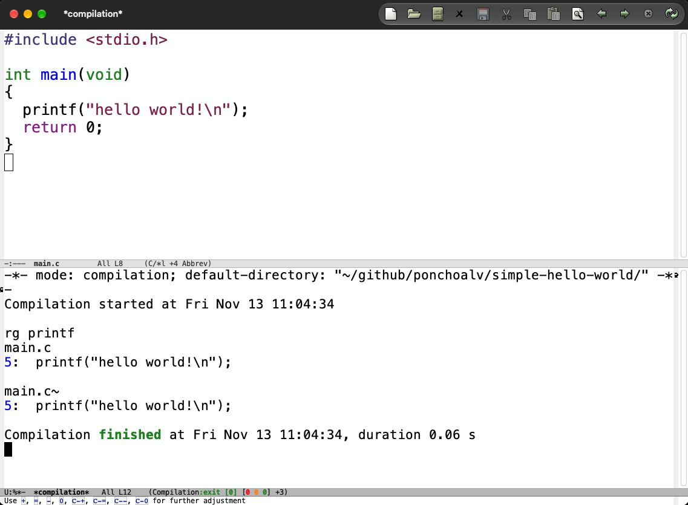
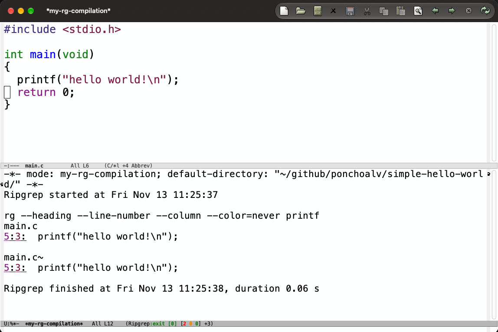

# Emacs `compile` workflow

During this little post I will show one of the workflows I use with Emacs.

> **TL;DR**\
> I will try to explain how I use `compile` command in Emacs.\
> Hot to move around errors `M-g M-n` or `` C-x ` `` for `next-error` and `M-g M-p` for `previous-error`.\
> Lastly other common usage `grip -rn 'pattern'` results jumping.

##  My Emacs workflow for writing code

In my experience when you are writing software you usually want to get quick feedback on how are you doing while writing and progressing on a task.

The way many people achieved this was by using a separate terminal running along side their editor (sometimes in the editor, like `vscode` case).

In Emacs we can choose on using an integrated terminal (like `eshell`, `eat`, `term`, `vterm` or even `ghostty`), an external terminal or, my favourite, using the `compile` interactive function.

## Compile

Compile, `M-x compile` is the place where you can run your build commands, make targets for launching tests, etc. It was created with that in mind, so it will give you fast feedback if succeed, but also, and more importantly, will give you feedback when your task failed. Not only that, but also will give a handful set of key-bindings which will ease the navigation around the errors.

### How it looks in case of success

Let's create a little program to showcase this (I will use vanilla Emacs started with -Q for the demonstrations).


Let's compile it with compile: `M-x compile RET cc main.c RET`


As you can see, we got in the `mode-line` an instant `exit [0] [0 0 0]` and in the compilation buffer `*compilation*` we got the invocation and output of the command.

We can also compile and run by just doing `cc main.c && ./a.out` and see the output of the program (or tests in most cases).


### How it looks when it failed?

With a little change we can make the compilation of our program to failed, changing `printf` to `brintf`.


Once we execute the compilation command the `*compilation*` buffer is showing us the failure in the in the buffer and also in the `mode-line` where `exit [1] [1 0 2]` reads as the command failed `exit [1]` due to this errors count is the first `[1`.

Its time to start moving around our errors and fix them.

#### How do you move around the compile errors?

There are a couple of default ways to move to the `next-error` which is pointer to were your code failed, the one I mechanise first is by using the following key-binding `` C-x ` `` or `M-x next-error`, if you are a mouse person, you could also click in the error and jump straight to your code in the failing line.


You could move in both directions `M-g M-n` for `next-error` or `M-g M-p` for `previous-error` too. I found it useful if you want to jump around results of search as we are going to discuss next.

### Bonus: Navigate `grep` results

The `compile` buffer also integrate well to other tools like `grep` command outputs, were we can quickly prompt `M-x compile` and then jump around the results using the `next-error` or `previous-error` functions.

The only thing to consider is that we need to run it with the flags `-rn` (it will run as `rgrip` / recursive grip and include in each line the filename and the line-number for the matches, needed by compile for doing the jumps).


## Can I customise how `compile` works?

Of course, you are in Emacs after all, you can do many changes, including the regex to use for deciding how to jump to the source code. Let's try to do it with a simple case, for example, what if I search using `rg` (`rip-grep` without any flag)




We won't be able to jump to results.

### How we customise it

The key customisation variables are: `compilation-error-regexp-alist-alist` and `compilation-error-regexp-alist` this are the core parsers: The -alist variable defines named rules, and `compilation-error-regexp-alist` activates them. Each definition has the shape


```lisp
(SYMBOL REGEXP FILE [LINE COLUMN TYPE HYPERLINK HIGHLIGHT...])
```
**Where:**

   * **`FILE`** (integer, list, `nil`, or function):
        * *Integer*: Capture group index for the file path.
        * *List `(GROUP FORMAT...)`*: Applies format strings (e.g., `(1 "%s.kt")`) until an existing file is found.
        * *`nil`*: Inherits the file name from the most recent match in the buffer that had one (used for grouped/multiline output).
        * *Function*: Called with point at the end of the match; must return `(FILENAME)` or `(RELATIVE-FILENAME . DIRNAME)`.

* **`LINE`** and **`COLUMN`**: Capture group index, or a cons cell `(START . END)` for ranges.

* **`TYPE`**: `2` (or `nil`) for error, `1` for warning, `0` for info, or `(WARNING-GROUP . INFO-GROUP)`.

* **`compilation-search-path`**: A list of directories (strings, or `nil` for `default-directory`) searched when matched file paths are relative and not in the current working directory.

* **`compilation-parse-errors-filename-function`**: A function that takes a matched filename string and returns a rewritten path—useful when build tools emit container paths, remote paths, or stripped prefixes.

* **`define-compilation-mode`**: Creates a dedicated major mode derived from `compilation-mode` with buffer-local `compilation-error-regexp-alist`, preventing loose custom patterns from colliding with normal compiler output.

* **`compilation-auto-jump-to-first-error`** & **`compilation-skip-threshold`**: Control whether `compile` jumps to the first match immediately and whether `next-error` skips info (`0`) or warning (`1`) matches.

The cleanest approach is a single `regexp` matching the `LINE:` (and optional `COLUMN:`) prefix paired with a `FILE` function that walks upward past contiguous match/context lines to read the file heading. Using `define-compilation-mode` keeps this rule isolated from standard compiler buffers:

First we look for the header (the file where we matched)
```lisp
(defun my-rg-heading-find-file ()
  "Return the file heading above a block of `rg --heading' match lines."
  (save-excursion
    (beginning-of-line)
    ;; Walk upward past match lines (`4:...') and context lines (`5-...')
    (while (and (zerop (forward-line -1))
                (looking-at-p "^[0-9]+[:-]")))
    (let ((file (string-trim
                 (buffer-substring-no-properties
                  (line-beginning-position) (line-end-position)))))
      (unless (string-empty-p file)
        (list file)))))
```

Then we match the line (and column) in that file
```lisp
(defvar my-rg-error-regexp-alist-alist
  '((rg-heading
     ;; Group 1: line number, Group 2 (optional): column number (for `rg --column')
     "^\\([0-9]+\\):\\(?:\\([0-9]+\\):\\)?"
     my-rg-heading-find-file
     1    ; LINE
     2))) ; COLUMN

```

And lastly we glue everything together
```lisp
(defvar my-rg-error-regexp-alist '(rg-heading))

(define-compilation-mode my-rg-compilation-mode "Ripgrep"
  "Compilation mode for `rg --heading' multiline output."
  (setq-local compilation-error-regexp-alist-alist my-rg-error-regexp-alist-alist)
  (setq-local compilation-error-regexp-alist my-rg-error-regexp-alist))

(defun my-rg-search (pattern)
  "Run `rg --heading' for PATTERN in `default-directory'."
  (interactive "srg search: ")
  (compilation-start
   (format "rg --heading --line-number --column --color=never %s"
           (shell-quote-argument pattern))
   'my-rg-compilation-mode))
```

Now, searching with `rg` using the new interactive function `my-rg-compilation` will display the results like this:



The underlined `number:column` (<u>5:3</u>) means that the `regex` we defined earlier matched and now the compile buffer is *linked* to the source code.

---


**PD:** Here is the full code for a custom matcher.
```lisp
(require 'compile)

(defun my-rg-heading-find-file ()
  "Return the file heading above a block of `rg --heading' match lines."
  (save-excursion
    (beginning-of-line)
    ;; Walk upward past match lines (`4:...') and context lines (`5-...')
    (while (and (zerop (forward-line -1))
                (looking-at-p "^[0-9]+[:-]")))
    (let ((file (string-trim
                 (buffer-substring-no-properties
                  (line-beginning-position) (line-end-position)))))
      (unless (string-empty-p file)
        (list file)))))

(defvar my-rg-error-regexp-alist-alist
  '((rg-heading
     ;; Group 1: line number, Group 2 (optional): column number (for `rg --column')
     "^\\([0-9]+\\):\\(?:\\([0-9]+\\):\\)?"
     my-rg-heading-find-file
     1    ; LINE
     2))) ; COLUMN

(defvar my-rg-error-regexp-alist '(rg-heading))

(define-compilation-mode my-rg-compilation-mode "Ripgrep"
  "Compilation mode for `rg --heading' multiline output."
  (setq-local compilation-error-regexp-alist-alist my-rg-error-regexp-alist-alist)
  (setq-local compilation-error-regexp-alist my-rg-error-regexp-alist))

(defun my-rg-search (pattern)
  "Run `rg --heading' for PATTERN in `default-directory'."
  (interactive "srg search: ")
  (compilation-start
   (format "rg --heading --line-number --column --color=never %s"
           (shell-quote-argument pattern))
   'my-rg-compilation-mode))

```
