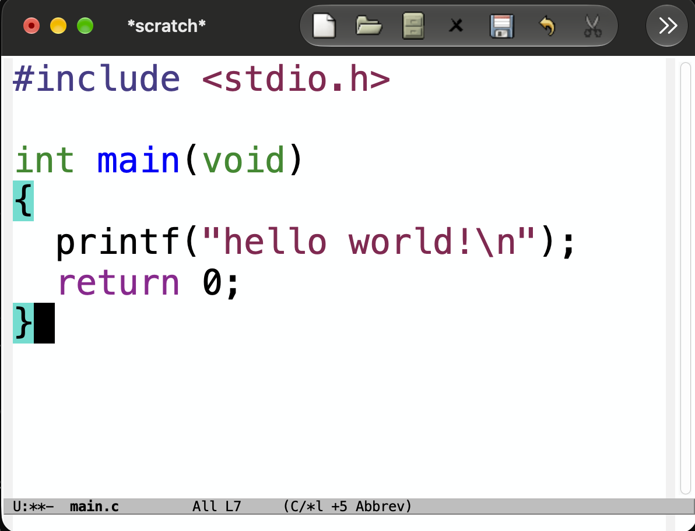
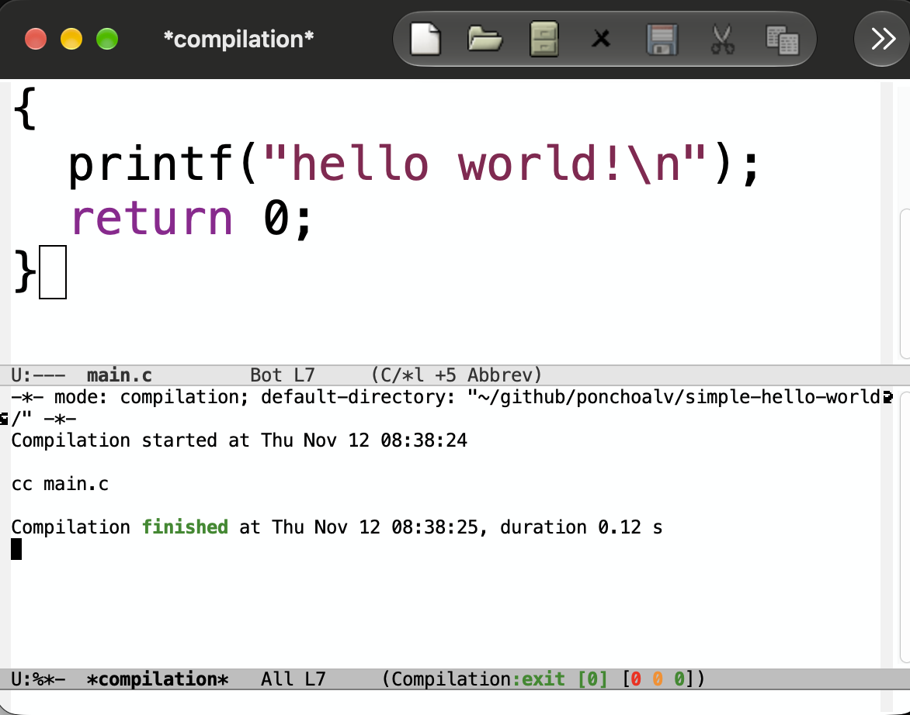
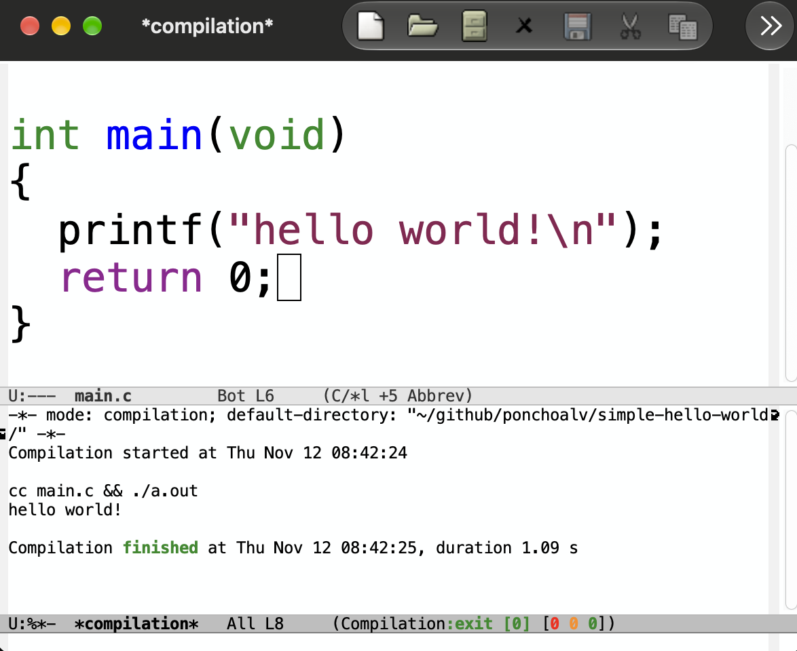
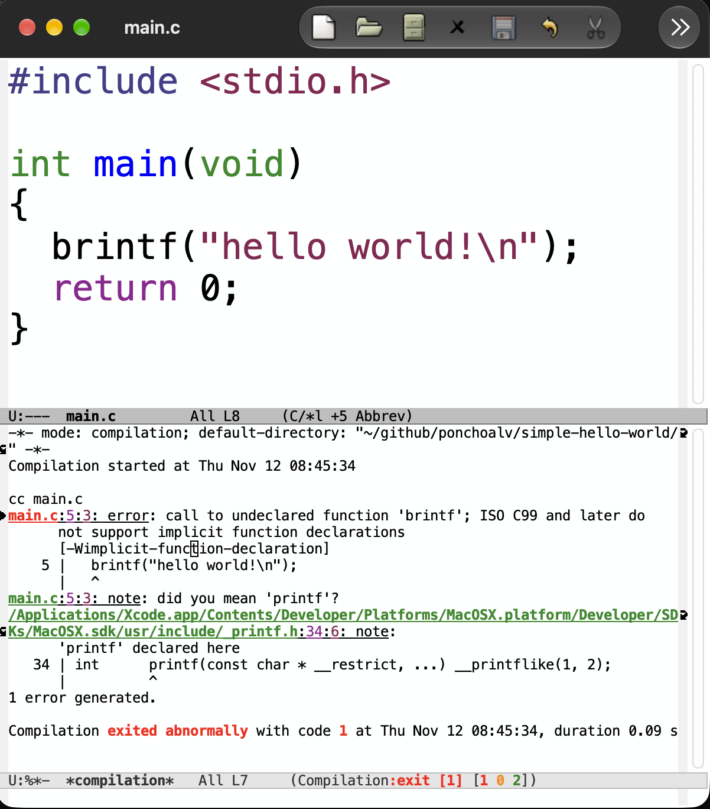
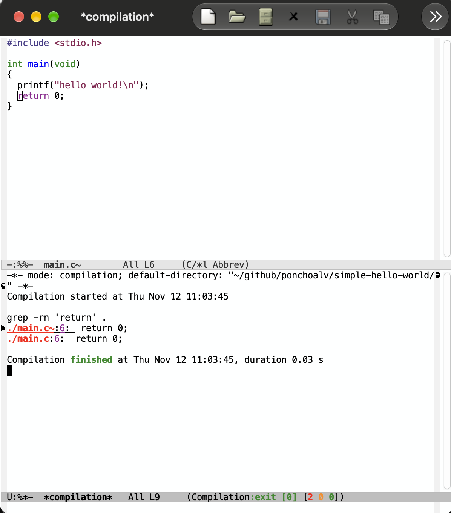

# Testing first entry

During this little test post I will show one of the the flows that Emacs enforce and I think it stays relevant on todays agentic programming loops.

> **TL;DR**\
> I will try to explain how to use `compile` command in Emacs.\
> We will learn how to move around errors `M-g M-n` or `` C-x `  `` for `next-error` and `M-g M-p` for `previous-error`.\
> Lastly other common usage `grip -rn 'pattern'` results jumping.

##  Vanilla Emacs flow

In my experience when you are writing software you usually want to get quick feedback on how are you doing while writing in this foreign language.

The way many people achieved this was by using a terminal with a shell running along side your editor (or within in the case of modern editors like vscode).

In Emacs we have a similar (within the editor) terminal, which is fully integrated to the editor called `eshell`. `Eshell` is great but we will cover that other day, but fundamentally wasn't built for that purpose.

So, if using a full terminal is not the idea, what I can do which fits better on a developer workflow?, compile.

## Compile

Compile, `M-x compile` is the place where you can run your build commands, make targets for launching tests, etc. It was created with that in mind, so it will give you fast feedback if succeed, but also, and more importantly, will give you feedback when your task failed. Not only that, but also will give a handful set of key-bindings which will ease the navigation around the errors.

### How it looks in case of success

Let's create a little program to showcase this (I will use vanilla Emacs started with -Q for the demonstrations).

Let's compile it with compile: `M-x compile RET cc main.c`

As you can see we got in the mode-line an instant `exit [0] [0 0 0]` and in the compilation buffer `*compilation*` we got the output of the command, in this case nothing.

We can also compile and run by just doing `cc main.c && ./a.out` and see the output of the program.

### How it looks when it failed

Now, let's make a little change to make the compilation to failed, changing `printf` to `brintf`.

We can see clearly how compile is showing us the failure `exit [1] [1 0 2]` which reads as the command failed `exit [1]` due to this errors count is the first `[1`. Now what we can do from here? Easy, jump to error and fix it.

#### How do you move around the compile errors?

The fastest and intuitive way for me is by using the following key-binding `` C-x ` `` or `M-x next-error`. But there are other ways to move in both directions `M-g M-n` for `next-error` or `M-g M-p` for `previous-error`.

### Bonus: Navigate `grep` results

This pattern or workflow is also useful and well integrated to other tools like `grep` command outputs, were we can quickly prompt `M-x compile` and then jump around the results using the `next-error` or `previous-error` functions.

The only thing to consider is that we need to run it with the flags `-rn` (this will include the filename and the line-number for the matches, needed by compile for doing the jumps).

## How this workflow compare to AI

Well in the agentic world we are `compiling` constantly from a natural language, with a little difference, we don't have a consistent way of telling if something failed, and if that's the case how do I jump to the thing that needs attention for a fix?
Does diff reviews enough? how do you understand what is going on when you scale up the amount of code produced by the agent?

I will leave this post here with this open questions...